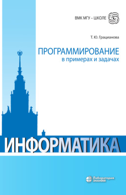
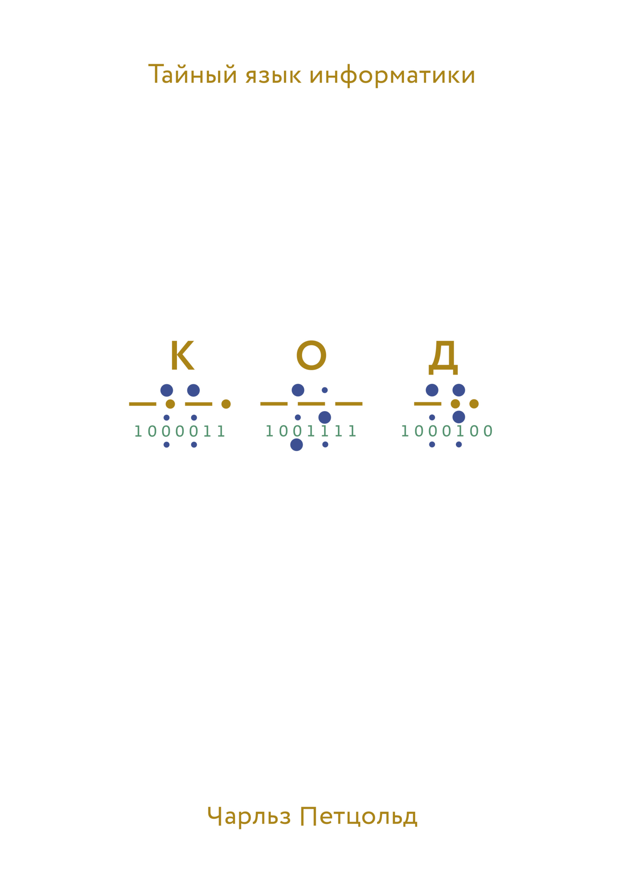
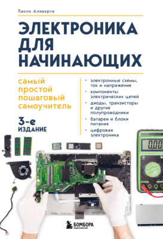
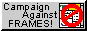

  
  
<em>Студент | Учу веб-разработку и DevOps | Создаю портфолио → ищу возможности </em>

---

###  Мои навыки

---

### 🎯 Цель

Создать **портфолио**, которое откроет двери:  
→ в стажировки 🎓  
→ в open-source 🌍  
→ в первую работу 💼  
→ в команду, где можно учиться и расти 🚀

---

---

### 📬 Связаться со мной

- Telegram: [@bly_41R](https://t.me/bly_41R)  
- GitHub: [@Kirill20202](https://github.com/Kirill20202)  
- Пиши — даже если просто хочешь поболтать о коде 😄

---

### Саморазвитие

  <!-- First row, a bit chaotic -->
  
  <!-- Second row, more chaos -->
   
  
  

---

> 🧠 *"Я не знаю всего — и это мой суперпавер. Потому что я учусь быстрее, чем другие думают."*

  
  
  

